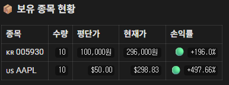
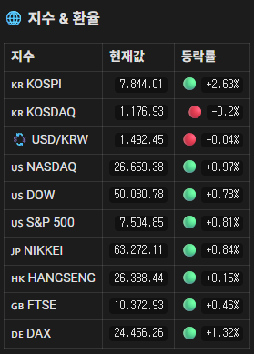
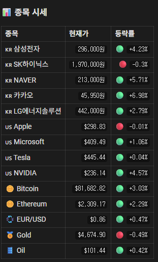
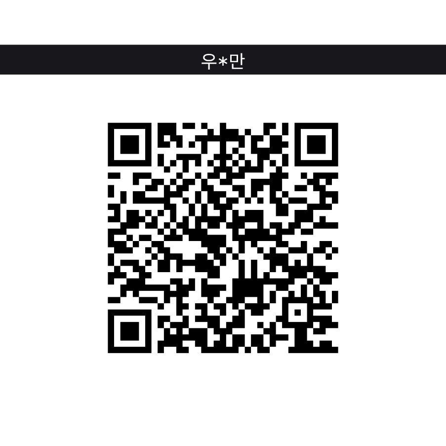

# Finance Kit

English · **[한국어](README.md)**

Track Korean and US stocks, crypto, FX, holdings P/L, and corporate disclosures right inside Home Assistant — on your wall tablet or phone.
No dashboard YAML to write, and no brokerage account login required.

[](https://hacs.xyz)
[](https://www.home-assistant.io)
[](https://github.com/redchupa/kr_finance_kit/releases)

---


### External data refresh

During market hours, quotes refresh every five minutes. Outside market hours and for filings, the interval is fifteen minutes. Per-symbol lookup time adds to these intervals. Brief price crossings or one-minute movements may be missed.

Each HA instance allows one lookup at a time per provider, with an 8–12 second gap after completion. Clients share cached quotes for five minutes and detailed metadata for six hours. Uncached Yahoo chart and search operations share a budget of 60 per hour. Refreshing the panel reads HA's snapshot.

A provider limit pauses lookups for at least fifteen minutes or longer when requested by Retry-After. OpenDart quota status 020 pauses requests for 24 hours. Cooldowns and caches are held in memory for the lifetime of the HA process.

## What makes it useful

- **Ready-to-use sidebar screen** — Installing Finance Kit adds a dedicated entry to your Home Assistant sidebar with indices, watchlist, crypto, holdings, and filings on one page. No custom dashboard required.
- **Browse and add symbols in one tap** — Pick from categorized Korean stocks and ETFs, US tech and ETFs, major crypto coins, gold, oil, and FX pairs without memorizing ticker codes. With a free OpenDart key, you can search all 2,600+ KRX listed companies by Korean name.
- **Holdings P/L and price alerts** — Open any stock to enter your shares, average price, and optional target or stop-loss price. Your total value and P/L are rolled up in KRW automatically, and you get highlighted alerts on screen and via phone notifications when a target is hit.
- **Automatic Kimchi Premium** — Add both `BTC-KRW` and `BTC-USD` to see the live Korean exchange premium right at the top of the screen.
- **Make it yours** — Choose from 13 card themes, 6 layouts (cards, list, compact, big number, heatmap, ticker tape), gain colors (red-up or green-up), section order, and mini charts. Preferences are saved per user across phone and tablet.
- **Voice assistant and daily briefings** — Ask Home Assistant Assist for quotes or market summaries, or have daily close recaps and price alerts pushed to your phone.
- **Free public data only** — Uses free public market quotes and OpenDart's free key. Never asks for brokerage passwords or account access.

<table>
<tr>
<td width="33%"></td>
<td width="33%"></td>
<td width="33%"></td>
</tr>
</table>

---

## Installation

Requires Home Assistant with [HACS](https://hacs.xyz).

### 1. Add the repository to HACS

Click the button below to open this repository directly in HACS on your Home Assistant instance:

[](https://my.home-assistant.io/redirect/hacs_repository/?owner=redchupa&repository=kr_finance_kit&category=integration)

Or add it manually via HACS menu → **Custom repositories**:
- Repository: `https://github.com/redchupa/kr_finance_kit`
- Category: `Integration`

### 2. Download and restart

1. Search for **Finance Kit** in HACS and download it.
2. **Restart** Home Assistant.

### 3. Add the integration

Go to **Settings → Devices & services → Add integration → Finance Kit**.

You can leave the ticker fields blank on first install — it starts with a sample watchlist (Samsung Electronics, SK hynix, Apple, NVIDIA, Microsoft, Bitcoin, Ethereum) that you can edit any time from the sidebar.

---

## Using the sidebar panel

Once installed, open **Finance Kit** from the Home Assistant sidebar.

- **Add symbols**: Tap **+ Add symbol** in the top right to browse Korea, US, Crypto, and Other categories with one-tap add buttons, search by name or code, or jump straight to KRX, Naver Finance, or Yahoo Finance to look up codes.
- **Holdings and price alerts**: Tap any stock to view its chart (1D, 5D, 1M, 6M, 1Y) and fill in **My position** — quantity, average price, and optional **Target (≥)** / **Stop-loss (≤)** alert prices.
  - Enter Korean stocks in KRW and US stocks in USD; currency conversion into your KRW total is handled automatically.
  - Alert prices appear right in your holdings list and light up as soon as a threshold is reached.
- **Customize**: Tap the settings icon to switch themes, layouts, gain colors, section order, and language (English / Korean).

> Only Home Assistant administrators can add or remove symbols and edit holdings; other household members get a safe read-only view.

---

## Phone notifications and automations

### Ready-made blueprints

Import any of these blueprints with one click and pick the symbols and phone you want to notify:

1. **Daily price move alert** — Notify when a symbol moves up or down by your chosen percentage from the previous close.
   [](https://my.home-assistant.io/redirect/blueprint_import/?blueprint_url=https%3A%2F%2Fgithub.com%2Fredchupa%2Fkr_finance_kit%2Fblob%2Fmain%2Fblueprints%2Fautomation%2Fkr_finance_kit%2Fprice_change_alert.yaml)
2. **Short-window alert** — Catch fast moves such as ±2% within 15 minutes (supports 1, 5, 15, 30, 60, 90, 120, and 180 minutes).
   [](https://my.home-assistant.io/redirect/blueprint_import/?blueprint_url=https%3A%2F%2Fgithub.com%2Fredchupa%2Fkr_finance_kit%2Fblob%2Fmain%2Fblueprints%2Fautomation%2Fkr_finance_kit%2Fshort_window_alert.yaml)
3. **Daily market summary** — Send one tidy recap of indices, FX, watchlist, and portfolio P/L after market close.
   [](https://my.home-assistant.io/redirect/blueprint_import/?blueprint_url=https%3A%2F%2Fgithub.com%2Fredchupa%2Fkr_finance_kit%2Fblob%2Fmain%2Fblueprints%2Fautomation%2Fkr_finance_kit%2Fdaily_summary.yaml)

### Target and stop-loss price alert

One short automation covers every holding that has a target or stop-loss price set in the sidebar:

```yaml
trigger:
  - platform: event
    event_type: kr_finance_kit_price_alert
action:
  - action: notify.mobile_app_my_phone
    data:
      title: "{{ trigger.event.data.name }} price alert"
      message: >
        {{ 'Target hit' if trigger.event.data.direction == 'high' else 'Stop-loss hit' }}:
        now {{ trigger.event.data.current_price }} (alert {{ trigger.event.data.target_price }})
```

More automation and custom dashboard examples are available in [docs/examples/](docs/examples/).

---

## Voice assistant

When connected to Home Assistant Assist with an LLM conversation agent, you can ask naturally:

- "What's KOSPI at right now?"
- "How much is Samsung Electronics?"
- "What's my biggest gainer today?"
- "Give me a quick market summary."
- "Any new filings on my watchlist?"

---

## FAQ

<details>
<summary><b>Does this connect to my brokerage account?</b></summary>

No. It relies only on public market data and the share counts / average prices you enter yourself.
</details>

<details>
<summary><b>Is it free to use?</b></summary>

Yes. Both the market data and OpenDart's disclosure API are free for personal use, and the integration is open source under the MIT license.
</details>

<details>
<summary><b>What happens on weekends and holidays?</b></summary>

Stock sensors display the last available closing price and handle Korean and US holidays automatically. Crypto, FX, and commodities continue updating 24/7.
</details>

<details>
<summary><b>Do I need an OpenDart API key?</b></summary>

No — stock prices, crypto, FX, holdings P/L, and price alerts all work without one. Adding a free OpenDart key unlocks Korean corporate disclosure alerts and full KRX company search.
</details>

<details>
<summary><b>How do I change options later?</b></summary>

Go to **Settings → Devices & services → Finance Kit → Configure**. Saving applies your changes automatically.
</details>

<details>
<summary><b>Not seeing updated prices or new screens?</b></summary>

After updating via HACS, restart Home Assistant and hard-refresh your browser (`Ctrl+Shift+R`). See [docs/installation-en.md](docs/installation-en.md) for more details.
</details>

---

## Support

If Finance Kit has been helpful, a coffee is always appreciated.

<table>
  <tr>
    <td align="center">
      <b>Toss (Korea)</b><br/>
      
    </td>
    <td align="center">
      <b>PayPal</b><br/>
      
    </td>
  </tr>
</table>

---

<sub>[Issues](https://github.com/redchupa/kr_finance_kit/issues) · [Releases](https://github.com/redchupa/kr_finance_kit/releases) · [MIT License](LICENSE)</sub>
