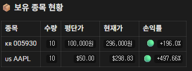
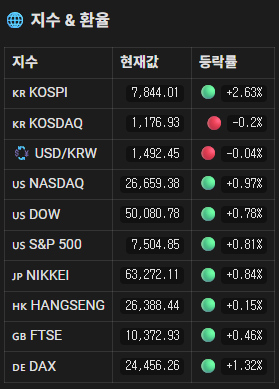
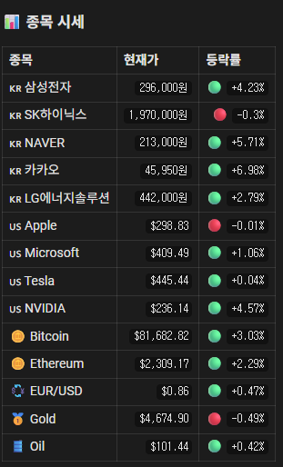
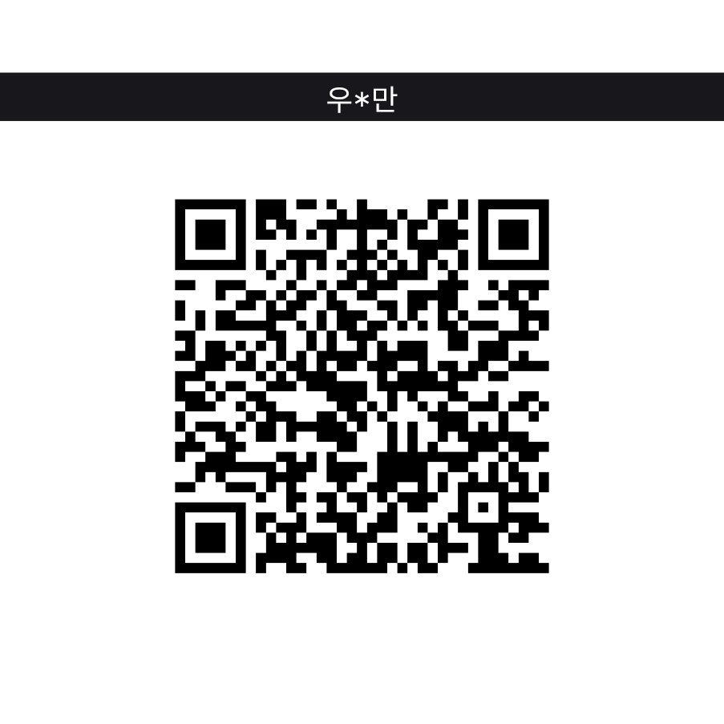

# Finance Kit

**[English](README.en.md)** · 한국어

거실 태블릿이나 휴대폰 Home Assistant에서 국내·미국 주식, 코인, 환율, 보유 종목 손익, 공시까지 한눈에 확인하세요.
대시보드를 직접 꾸밀 필요도, 증권사 계정을 연결할 필요도 없습니다.

[](https://hacs.xyz)
[](https://www.home-assistant.io)
[](https://github.com/redchupa/kr_finance_kit/releases)

---

## 왜 Finance Kit인가요

- **설치하자마자 바로 쓰는 전용 화면** — 설치하면 Home Assistant 왼쪽 메뉴에 `Finance Kit` 화면이 생깁니다. 복잡한 대시보드 설정 없이 코스피·나스닥·관심 종목·코인·보유 현황·공시를 한곳에서 볼 수 있습니다.
- **코드를 몰라도 쉽게 종목 추가** — 국내 대형주·코스닥·ETF, 미국 빅테크·ETF, 주요 코인, 금·원유·환율까지 카테고리에서 골라 클릭 한 번으로 추가할 수 있습니다. OpenDart 무료 키를 넣으면 국내 상장사 전체(2,600여 개)를 한글 이름으로 바로 검색할 수 있습니다.
- **보유 종목 손익과 목표가·손절가 알림** — 종목을 눌러 수량과 평단가, 원하는 목표가·손절가를 적어두면 총 평가금액과 수익률을 원화로 합산해 보여주고, 설정한 가격에 도달하면 화면과 휴대폰 알림으로 알려줍니다.
- **김치 프리미엄 자동 계산** — 비트코인 원화(`BTC-KRW`)와 달러(`BTC-USD`)를 함께 추가해 두면 현재 김치 프리미엄이 상단에 자동으로 표시됩니다.
- **내 취향대로 꾸미는 화면** — 13가지 카드 테마, 6가지 레이아웃(카드·리스트·컴팩트·빅넘버·히트맵·티커테이프), 상승 색상(한국식 빨강 / 글로벌 초록), 섹션 순서와 미니 차트까지 클릭으로 바꿀 수 있습니다.
- **음성 비서와 자동화 알림** — "삼성전자 지금 얼마야?"처럼 말로 물어보거나, 장 마감 요약·급등락 알림·신규 공시 알림을 휴대폰으로 받아볼 수 있습니다.
- **완전 무료, 증권사 로그인 없음** — 공개 시세와 금융감독원 OpenDart 무료 키만 사용합니다. 계좌 비밀번호나 증권사 로그인은 일절 요구하지 않습니다.

<table>
<tr>
<td width="33%"></td>
<td width="33%"></td>
<td width="33%"></td>
</tr>
</table>

---

## 설치 방법

Home Assistant에 [HACS](https://hacs.xyz)가 설치되어 있으면 3단계로 끝납니다.

### 1. HACS에 저장소 추가

아래 버튼을 누르면 사용 중인 Home Assistant의 HACS 화면으로 바로 연결됩니다.

[](https://my.home-assistant.io/redirect/hacs_repository/?owner=redchupa&repository=kr_finance_kit&category=integration)

버튼이 동작하지 않는다면 HACS 우측 상단 메뉴 → **사용자 정의 저장소**에서 아래 주소를 직접 추가해 주세요.
- 주소: `https://github.com/redchupa/kr_finance_kit`
- 유형: `통합 구성요소 (Integration)`

### 2. 다운로드 후 재시작

1. HACS에서 **Finance Kit**을 검색해 다운로드합니다.
2. Home Assistant를 **재시작**합니다.

### 3. 통합 추가

**설정 → 기기 및 서비스 → 통합 구성요소 추가 → Finance Kit**을 선택합니다.

처음 설치할 때 종목 칸을 비워두어도 괜찮습니다. 대표 종목(삼성전자·SK하이닉스·애플·엔비디아·마이크로소프트·비트코인·이더리움)이 자동으로 채워져 바로 화면을 둘러볼 수 있고, 나중에 사이드바에서 언제든 바꿀 수 있습니다.

---

## 사이드바 화면 사용법

설치가 끝나면 Home Assistant 왼쪽 메뉴에 **Finance Kit**이 나타납니다.

- **종목 추가**: 오른쪽 위 **+ 종목 추가** 버튼을 누르면 국내·미국·코인·기타 탭별로 인기 종목 목록이 열립니다. 원하는 종목 옆의 **+ 추가**를 눌러 여러 종목을 한 번에 담을 수 있고, 검색창에서 한글 이름이나 코드로 찾을 수도 있습니다. 코드를 직접 찾고 싶을 때를 위해 KRX·네이버 금융·Yahoo Finance 바로가기도 함께 들어 있습니다.
- **보유 종목 및 가격 알림**: 아무 종목이나 눌러 상세 화면을 열면 기간별 차트(1일, 5일, 1개월, 6개월, 1년)와 함께 **내 보유** 입력란이 나옵니다. 수량, 평단가, 그리고 선택 사항으로 **목표가(이상)** 와 **손절가(이하)** 를 입력하고 저장하면 됩니다.
  - 한국 주식은 원(KRW), 미국 주식은 달러(USD) 그대로 입력하면 환율이 자동 반영됩니다.
  - 보유 종목 목록에 설정한 알림 가격이 표시되며, 가격에 도달하면 강조 배지로 바로 확인할 수 있습니다.
- **화면 꾸미기**: 오른쪽 위 설정 아이콘에서 테마, 레이아웃, 상승 색상, 섹션 순서, 언어(한국어 / English)를 바꿀 수 있습니다. 설정은 사용자마다 따로 저장되므로 휴대폰과 태블릿에서 각자 편한 화면으로 쓸 수 있습니다.

> 종목 추가·삭제와 보유 정보 수정은 관리자 계정만 가능하며, 가족 등 일반 사용자는 보기 전용으로 안전하게 이용할 수 있습니다.

---


### 외부 데이터 갱신 주기

시세는 장중 3분, 장외 10분, 공시는 15분 간격으로 갱신합니다. 실제 갱신에는 종목별 조회 시간도 더해집니다. 1분 단위 급등락이나 목표가 도달 알림은 지연되거나 짧은 변동을 놓칠 수 있습니다.

HA 인스턴스마다 Yahoo와 OpenDart를 각각 한 번에 하나씩 조회하며, 호출 완료 후 다음 조회까지 Yahoo는 6~9초, OpenDart는 8~12초를 둡니다. 여러 기기가 같은 데이터를 요청하면 결과를 공유합니다. 시세는 3분, 상세 정보는 6시간 동안 재사용합니다. Yahoo 차트와 검색의 새 조회는 합계 시간당 최대 60회입니다. 패널 화면 갱신은 HA가 가진 데이터를 읽습니다.

공급자가 요청 제한을 알리면 최소 15분 쉬고, 전달받은 재시도 시간이 더 길면 그 시간을 따릅니다. OpenDart의 할당량 초과 응답(020)은 24시간 쉽니다. 대기 상태와 캐시는 HA 프로세스 메모리에 유지됩니다.

## 휴대폰 알림 자동화

Home Assistant 알림과 연결하면 시세를 계속 들여다보지 않아도 중요한 순간만 받아볼 수 있습니다.

### 원클릭 블루프린트 3종

버튼을 눌러 바로 가져온 뒤 알림 받을 종목과 휴대폰만 고르면 됩니다.

1. **전일 대비 등락률 알림** — 선택한 종목이 전일 종가 대비 설정한 비율만큼 오르거나 내리면 알림
   [](https://my.home-assistant.io/redirect/blueprint_import/?blueprint_url=https%3A%2F%2Fgithub.com%2Fredchupa%2Fkr_finance_kit%2Fblob%2Fmain%2Fblueprints%2Fautomation%2Fkr_finance_kit%2Fprice_change_alert.yaml)
2. **단기 급등락 알림** — "최근 15분 동안 2% 이상 움직였을 때"처럼 짧은 시간의 급변을 포착 (1·5·15·30·60·90·120·180분 지원)
   [](https://my.home-assistant.io/redirect/blueprint_import/?blueprint_url=https%3A%2F%2Fgithub.com%2Fredchupa%2Fkr_finance_kit%2Fblob%2Fmain%2Fblueprints%2Fautomation%2Fkr_finance_kit%2Fshort_window_alert.yaml)
3. **일일 시장 요약** — 매일 장 마감 후 지수·환율·관심 종목·내 평가손익을 한 메시지로 정리해 발송
   [](https://my.home-assistant.io/redirect/blueprint_import/?blueprint_url=https%3A%2F%2Fgithub.com%2Fredchupa%2Fkr_finance_kit%2Fblob%2Fmain%2Fblueprints%2Fautomation%2Fkr_finance_kit%2Fdaily_summary.yaml)

### 보유 종목 목표가·손절가 도달 알림

사이드바에서 목표가나 손절가를 설정해 두면, 가격이 돌파되는 순간 Home Assistant에 알림 신호가 발생합니다. 아래 자동화를 하나만 만들어 두면 모든 보유 종목의 목표가·손절가 알림을 휴대폰으로 받을 수 있습니다.

```yaml
trigger:
  - platform: event
    event_type: kr_finance_kit_price_alert
action:
  - action: notify.mobile_app_my_phone
    data:
      title: "{{ trigger.event.data.name }} 가격 알림"
      message: >
        {{ '목표가 도달' if trigger.event.data.direction == 'high' else '손절가 도달' }}:
        현재가 {{ trigger.event.data.current_price }} (기준 {{ trigger.event.data.target_price }})
```

더 많은 자동화와 직접 꾸미는 대시보드 예시는 [docs/examples/](docs/examples/)에서 확인할 수 있습니다.

---

## 음성 비서로 물어보기

Home Assistant Assist에 음성 비서(ChatGPT, Gemini, 로컬 음성 비서 등)를 연결해 두셨다면 말로 바로 시세를 물어볼 수 있습니다.

- "코스피 지금 얼마야?"
- "삼성전자 주가 알려줘"
- "오늘 내 관심 종목 중에 제일 많이 오른 건 뭐야?"
- "오늘 시장 상황 요약해 줘"
- "관심 종목에 새 공시 올라온 거 있어?"

---

## 자주 묻는 질문

<details>
<summary><b>증권사 계정을 연결해야 하나요?</b></summary>

아니요. 계좌 연동 없이 공개 시세와 직접 입력한 보유 수량·평단가만 사용하므로 보안 걱정 없이 쓸 수 있습니다.
</details>

<details>
<summary><b>사용료가 있나요?</b></summary>

무료입니다. 시세 조회와 금융감독원 OpenDart 공시 API 모두 개인 사용 범위에서 무료로 제공됩니다.
</details>

<details>
<summary><b>주말이나 장 마감 후에는 어떻게 표시되나요?</b></summary>

국내·미국 주식은 직전 거래일 종가를 보여주며, 한국·미국 공휴일도 자동으로 처리됩니다. 비트코인 등 코인과 환율·원자재는 24시간 계속 갱신됩니다.
</details>

<details>
<summary><b>OpenDart API 키는 꼭 넣어야 하나요?</b></summary>

필수는 아닙니다. 키 없이도 주가·환율·코인·보유 손익·가격 알림은 모두 정상 동작합니다. 다만 OpenDart 무료 키를 입력하면 관심 종목의 신규 공시 알림과 국내 상장사 전체 검색 기능이 추가로 열립니다.
</details>

<details>
<summary><b>옵션을 나중에 바꾸고 싶어요.</b></summary>

**설정 → 기기 및 서비스 → Finance Kit → 구성(옵션)** 에서 언제든 바꿀 수 있습니다. 저장하면 통합이 자동으로 다시 불러와집니다.
</details>

<details>
<summary><b>가격이 표시되지 않거나 새 메뉴가 안 보일 때는?</b></summary>

HACS 업데이트 직후에는 Home Assistant를 재시작한 뒤 브라우저를 새로고침(`Ctrl+Shift+R`)해 주세요. 자세한 설치·문제 해결 안내는 [docs/installation-ko.md](docs/installation-ko.md)를 참고해 주세요.
</details>

---

## 후원

유용하게 쓰고 계시다면 커피 한 잔으로 응원해 주세요.

<table>
  <tr>
    <td align="center">
      <b>토스</b><br/>
      
    </td>
    <td align="center">
      <b>PayPal</b><br/>
      
    </td>
  </tr>
</table>

---

<sub>[문의 및 제보](https://github.com/redchupa/kr_finance_kit/issues) · [업데이트 내역](https://github.com/redchupa/kr_finance_kit/releases) · [MIT 라이선스](LICENSE)</sub>
